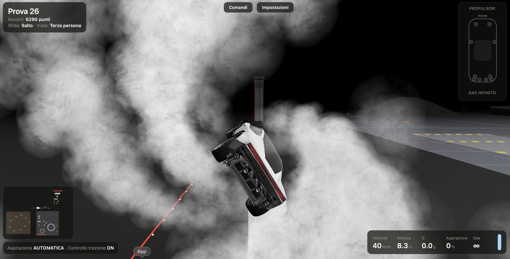

# Rocket Roadster
**Tesla Roadster Simulation** · simulatore 3D nel browser, con controller PS5

🇮🇹 Italiano · [🇬🇧 English](#english)

### ▶ [Gioca subito online](https://francesco2011-source.github.io/rocket-roadster/)
Nessuna installazione: apri il link con Chrome o Edge, collega il controller PS5 e premi un tasto.



Simulatore 3D che gira nel browser: guidi una Tesla Roadster dotata di 10 propulsori a gas compresso e di una ventola di aspirazione sotto il pianale (il pacchetto SpaceX descritto nel codice). La guida è libera, con fisica a corpo rigido, e si controlla soprattutto con il **controller PS5 (DualSense)**; funziona anche con tastiera e mouse. Non serve nessuna build: si avvia con un piccolo server locale in Python e usa la libreria three.js inclusa nel repository.

> Progetto amatoriale non ufficiale, non affiliato a Tesla o SpaceX.

## Requisiti
- **Python 3** (serve solo per il mini server locale `serve.py`: i moduli ES non si caricano da `file://`)
- Un browser con supporto WebGL e Gamepad API (il codice è pensato per Chrome/Edge; per i controller PlayStation gestisce anche le mappature diverse di Firefox e Safari)

## Avvio

| Sistema | Come |
|---|---|
| **macOS** | doppio clic su `start-mac.command` (la prima volta: clic destro → Apri; se serve, `chmod +x start-mac.command`) |
| **Windows** | doppio clic su `start-windows.bat` (usa `py -3` oppure `python`; se Python non c'è, mostra un messaggio) |
| **Terminale** | `python3 serve.py` (su Windows `py -3 serve.py`) |

`serve.py` parte dalla porta 8000 (se è occupata prova le successive, fino a 20), stampa l'indirizzo, per esempio `http://localhost:8000`, e apre il browser da solo. Si ferma con `Ctrl+C`.

Nella schermata iniziale clicca oppure premi ✕ per cominciare.

## Controller PS5 (consigliato)
Collega il DualSense via USB o Bluetooth e **premi un tasto**: viene riconosciuto da solo e compare una notifica "Controller collegato". Sono supportati anche DualShock 4 e controller Xbox (A=✕, B=○, X=□, Y=△, View=CREATE, Menu=OPTIONS). Il gioco usa anche la vibrazione del controller (se il browser la espone).

| Controller PS5 | Azione | Tastiera / mouse |
|---|---|---|
| R2 / L2 | Accelera / frena (da fermo: retromarcia) | W / S (anche ↑ / ↓) |
| Stick sinistro | Sterza (in aria: capriola e giro su sé stessa) | A D · W S (anche frecce) |
| ✕ | Getti di sollevamento | Spazio |
| ○ | Boost posteriore | Shift |
| □ | Getti frenanti anteriori | C |
| L1 / R1 | Capovolgi di lato (a terra: gira su sé stessa) | Q / E |
| △ | Cambia visuale (terza persona, abitacolo, laterale, drone) | V |
| Touchpad / L3 | Cambia sfida | T |
| CREATE | Raddrizza l'auto | F |
| OPTIONS | Ricomincia (tenuto premuto 0,6 s: impostazioni) | R (P: impostazioni) |
| Stick destro | Ruota la telecamera | trascina col mouse |
| R3 | Distanza della telecamera | Z / rotella |
| D-pad ↑ / ↓ | Aspirazione manuale: più / meno | M / N |
| D-pad → | Aspirazione automatica / manuale | G |
| D-pad ← | Controllo di trazione ON/OFF | H |

Il pulsante **Comandi** in alto (oppure `?` / `F1`) mostra la stessa tabella nel gioco.

## Sfide
Si cambia sfida con Touchpad / L3 / `T`. Sono cinque:

| Sfida | Descrizione (dal gioco) |
|---|---|
| **Rampa** | Sali sulla J, staccati e atterra nella zona. Rampa a J: curva r = 7 m, parete 9 m, uncino r = 5 m a 90°, labbro 3 m, larghezza 4,6 m; zona di atterraggio a x = −24 |
| **Salto** | Supera i cinque veicoli parcheggiati (zona di atterraggio a x = −76) |
| **Mappa test** | Area di prova a griglia: dossi, onda di lavatrice e campo di sassi, rampe a 10°/20°/30°/40°, scale e muro, salto lungo, pista circolare sopraelevata, salita sulla collina conica, skidpad e slalom, casse da sfondare (un muro 4 × 5 e una piramide da 21) |
| **Parco acrobazie** | Trampolini, table-top, giro della morte a elica, half-pipe e slalom |
| **Colline** | Sterrato tra le colline: meno aderenza, tanti salti |

**Punteggio** (calcolato dal codice a ogni atterraggio): altezza di stacco (60 punti/m), tempo in aria (150/s), giri completi (1500 l'uno), atterraggio morbido (fino a 1200), auto in piano (fino a 600), gas avanzato (fino a 800), nella zona (+1000); nel Salto 600 punti per ogni veicolo superato. Un atterraggio sulle ruote oltre 12 m/s è uno schianto: puoi comunque ripartire, raddrizzare l'auto (CREATE) o ricominciare (OPTIONS). Il record viene salvato nel browser.

## Impostazioni
Si aprono con il pulsante **Impostazioni**, con `P` o tenendo premuto OPTIONS; il gioco va in pausa e le scelte restano salvate nel browser. Dal controller: D-pad ↑↓ per scegliere, ←→ per regolare, ○ per chiudere.

| Impostazione | Intervallo (valore iniziale) |
|---|---|
| Gas compresso | 100–2000 L, oppure infinito (600 L) |
| Consumo del sollevamento | 50–600 L/s (180) |
| Spinta di sollevamento | 1,4–4 g (2,4) |
| Spinta del boost | 0,5–5 g (2,2) |
| Densità dell'aria compressa (nebbia) | 40–250 % (140 %) |
| Aderenza della strada | μ 0,4–1,4 (0,85) |
| Botto al distacco dalla rampa | 0–100 % (100) |
| Asse verticale telecamera | normale / invertito |
| Volume | 0–100 % (80) |
| Lingua | Italiano / English |

Il gas si ricarica con OPTIONS (ricomincia) oppure fermandosi sulla stazione "GAS" presente nella mappa.

## Come funziona (dal codice)
- **Auto**: 1745 kg + 155 kg di azoto (600 L a ~690 bar) che si consumano durante l'uso; passo 2,65 m; trazione posteriore, 10.000 Nm e 1000 kW; velocità massima ~370 km/h.
- **Fisica**: corpo rigido 3D con 8 sotto-passi per fotogramma; sospensioni indipendenti a molla e ammortizzatore; gomme con formula magica di Pacejka (longitudinale e laterale) e cerchio d'attrito (μ 1,25); sterzo Ackermann; controllo di trazione, ABS e controllo di stabilità (ESC) con torque vectoring sui due motori posteriori; resistenza aerodinamica e deportanza.
- **Aspirazione**: ventola sotto il pianale fino a ~2 g di deportanza; la tenuta dipende dall'altezza da terra. In automatico si attiva sopra 60 km/h, sulla rampa e nel giro della morte, mai in retromarcia.
- **Propulsori**: 10 ugelli: 4 posteriori fissi (boost) e 6 orientabili (gimbal fino a 35°, fino a 11 kN ciascuno: 2 anteriori sotto lo splitter, 2 nelle minigonne, 2 agli angoli posteriori). Servono per sollevamento, frenata, spinta laterale e assetto, con stabilizzazione automatica in volo. Le posizioni sono una ricostruzione, non dati ufficiali.
- **Aria compressa**: nebbia volumetrica di condensa con particelle che collidono con auto, rampe e terreno.
- **Suoni**: sintetizzati in tempo reale con Web Audio (nessun file audio).
- **Lingue**: italiano e inglese, scelta automatica dal browser e cambiabile nelle impostazioni.

## Struttura del progetto
```
index.html          pagina e interfaccia (HUD, comandi, impostazioni)
game.js             motore: fisica, input, telecamera, audio, particelle, sfide
routes.js           mappa test, parco acrobazie e colline
roadster-model.js   auto procedurale (usata se manca il modello .glb)
wheels.js           ruote costruite da zero
i18n.js             traduzioni italiano / inglese
serve.py            server locale (python3 serve.py)
start-mac.command   avvio su macOS
start-windows.bat   avvio su Windows
vendor/three/       three.js (MIT), incluso
.github/workflows/  pubblicazione su GitHub Pages
docs/               screenshot
```

## Modello 3D (opzionale)
Il modello della Tesla **non è incluso** (licenza sconosciuta). Il gioco cerca `models/tesla-roadster-2026.glb`; se il file non c'è usa l'auto procedurale di `roadster-model.js`. Se hai un tuo modello, copialo in quel percorso (la cartella `models/` è ignorata da git). Vedi [CREDITS.md](CREDITS.md).

## Pubblicazione online (GitHub Pages)
Nelle impostazioni del repository: *Settings → Pages → Source: GitHub Actions*. Il workflow incluso (`.github/workflows/pages.yml`) pubblica il gioco a ogni push su `main`.

## Licenza
MIT (codice). Asset di terze parti: vedi [CREDITS.md](CREDITS.md).

---

<a id="english"></a>
# English

### ▶ [Play online now](https://francesco2011-source.github.io/rocket-roadster/)
No install: open the link in Chrome or Edge, connect the PS5 controller and press any button.


A 3D simulator that runs in the browser: you drive a Tesla Roadster fitted with 10 compressed-gas thrusters and an underfloor suction fan (the SpaceX package described in the code). Free-roam driving with rigid-body physics, designed mainly for the **PS5 DualSense controller**; keyboard and mouse work too. No build step: a tiny local Python server serves the game, and three.js is bundled in the repository.

> Unofficial fan project, not affiliated with Tesla or SpaceX.

## Requirements
- **Python 3** (only for the local server `serve.py`; ES modules don't load from `file://`)
- A browser with WebGL and the Gamepad API (written for Chrome/Edge; PlayStation controllers with the different Firefox/Safari mappings are normalised too)

## Run

| OS | How |
|---|---|
| **macOS** | double-click `start-mac.command` (first time: right-click → Open; if needed `chmod +x start-mac.command`) |
| **Windows** | double-click `start-windows.bat` (uses `py -3` or `python`, prints a message if Python is missing) |
| **Terminal** | `python3 serve.py` (Windows: `py -3 serve.py`) |

`serve.py` starts on port 8000 (tries up to 19 further ports if it's busy), prints the address, e.g. `http://localhost:8000`, and opens your browser. Stop it with `Ctrl+C`. On the start screen click or press ✕ to begin.

## PS5 controller (recommended)
Connect the DualSense via USB or Bluetooth and **press any button**: it is detected automatically (a "Controller connected" notice appears). DualShock 4 and Xbox pads work too (A=✕, B=○, X=□, Y=△, View=CREATE, Menu=OPTIONS). Controller rumble is used when the browser exposes it.

| PS5 pad | Action | Keyboard / mouse |
|---|---|---|
| R2 / L2 | Accelerate / brake (stopped: reverse) | W / S (or ↑ / ↓) |
| Left stick | Steer (in air: flip and spin) | A D · W S (or arrows) |
| ✕ | Lift thrusters | Space |
| ○ | Rear boost | Shift |
| □ | Front braking jets | C |
| L1 / R1 | Barrel-roll (on ground: turn in place) | Q / E |
| △ | Change camera (third person, cockpit, side, drone) | V |
| Touchpad / L3 | Change challenge | T |
| CREATE | Right the car | F |
| OPTIONS | Restart (hold 0.6 s: settings) | R (P: settings) |
| Right stick | Orbit camera | mouse drag |
| R3 | Camera distance | Z / wheel |
| D-pad ↑ / ↓ | Manual suction: more / less | M / N |
| D-pad → | Suction auto / manual | G |
| D-pad ← | Traction control on/off | H |

The **Controls** button at the top (or `?` / `F1`) shows the same table in-game.

## Challenges
Switch with Touchpad / L3 / `T`. There are five: **Ramp** (climb the J, let go and land in the zone), **Jump** (clear the five parked vehicles), **Test grid** (bumps, washboard and rock field, 10°/20°/30°/40° ramps, stairs and wall, long jump, banked circular track, conical hill climb, skidpad and slalom, crates to smash), **Stunt park** (kickers, table-top, helix loop, half-pipe, slalom) and **Hills** (dirt between hills: less grip, lots of jumps).

**Scoring** (computed by the code at each landing): release height (60 pts/m), airtime (150/s), full turns (1500 each), soft landing (up to 1200), car level (up to 600), gas left (up to 800), on target (+1000); in Jump, 600 pts per vehicle cleared. A wheels-down landing above 12 m/s is a crash; you can keep going, right the car (CREATE) or restart (OPTIONS). The best score is saved in the browser.

## Settings
Open with the **Settings** button, `P`, or by holding OPTIONS; the game pauses and choices are saved in the browser. Gamepad: D-pad ↑↓ to pick, ←→ to adjust, ○ to close. Adjustable: compressed gas (100–2000 L or infinite; default 600), lift gas burn (50–600 L/s; 180), lift thrust (1.4–4 g; 2.4), boost thrust (0.5–5 g; 2.2), compressed-air density (40–250 %; 140 %), road grip (μ 0.4–1.4; 0.85), ramp-hook impact bang (0–100 %), camera vertical axis, volume (0–100 %; 80) and language (Italiano / English). Gas is refilled by restarting (OPTIONS) or by stopping on the "GAS" station in the map.

## How it works (from the code)
- **Car**: 1745 kg + 155 kg of nitrogen (600 L at ~690 bar) that is used up as you go; 2.65 m wheelbase; rear-wheel drive, 10,000 Nm and 1000 kW; top speed ~370 km/h.
- **Physics**: 3D rigid body with 8 sub-steps per frame; independent spring/damper suspension; Pacejka magic-formula tyres (longitudinal and lateral) with a friction circle (μ 1.25); Ackermann steering; traction control, ABS and stability control (ESC) with torque vectoring on the two rear motors; drag and downforce.
- **Suction**: underfloor fan up to ~2 g of downforce, with a seal that depends on ride height. In auto mode it switches on above 60 km/h, on the ramp and in the loop, never in reverse.
- **Thrusters**: 10 nozzles: 4 fixed rear (boost) and 6 gimballed (up to 35°, up to 11 kN each: 2 front under the splitter, 2 in the side skirts, 2 at the rear corners), used for lift, braking, lateral thrust and attitude, with automatic stabilisation in flight. Positions are a reconstruction, not official data.
- **Compressed air**: volumetric condensation fog whose particles collide with the car, ramps and ground.
- **Sound**: synthesised in real time with Web Audio (no audio files).
- **Languages**: Italian and English, picked from the browser and switchable in Settings.

## Project layout
See the tree in the Italian section above.

## 3D model (optional)
The Tesla model is **not included** (unknown license). The game looks for `models/tesla-roadster-2026.glb`; without it a procedural car from `roadster-model.js` is used. Drop your own model at that path (`models/` is git-ignored). See [CREDITS.md](CREDITS.md).

## Publish online (GitHub Pages)
*Settings → Pages → Source: GitHub Actions*; the included workflow (`.github/workflows/pages.yml`) deploys on every push to `main`.

## License
MIT (code). Third-party assets: see [CREDITS.md](CREDITS.md).
